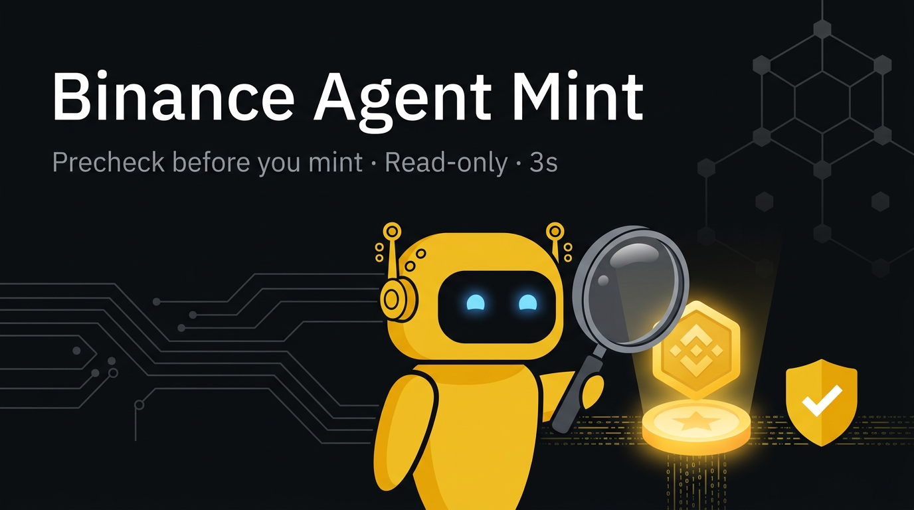
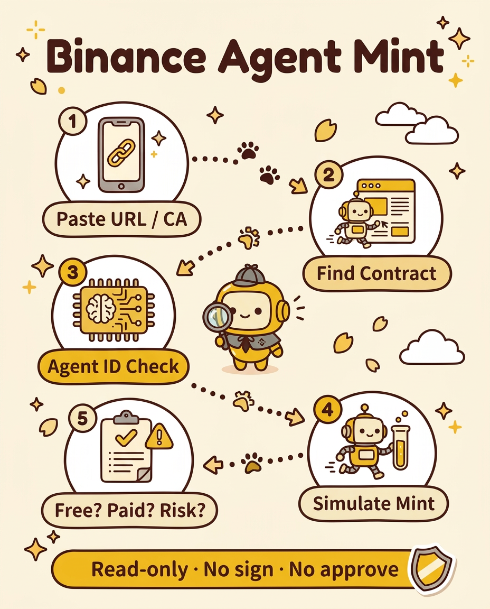

# Binance Agent Mint 🤖🛡️



**English** | [中文](#中文说明)

> Read-only precheck for Binance Agent ID (BSC) mints. Paste a URL or contract address, get free / paid / supply / eligibility / risk in ~3 seconds.

**Fully read-only: no signing, no approvals, no payments, no transactions.** You decide whether to mint.



## Features
- **URL or CA input** – finds the mint contract from the page, same-site JS, `/agents.md`, `/llms.txt`; filters out infra addresses (WBNB, USDT, routers…)
- **Proxy detection** – EIP-1967 / Beacon / EIP-1167, follows to the implementation and flags upgradeability
- **ABI** – Sourcify verified source first, openchain signature DB as fallback (cached locally)
- **Parallel reads** – name, total supply, minted, price, free remaining, per-wallet cap, open/paused, start/end time, owner powers
- **Mint simulation** – `eth_call` + `estimateGas` with balance override, so you know if it will revert before you sign anything
- **Binance Agent ID gate check** – registry `0x60b9…022f`; checks free quota / claimed status by your Agent ID tokenId
- **10 verdicts** – OPEN_FREE / OPEN_PAID / SOLD_OUT / ENDED / CLOSED / NOT_STARTED / WALLET_LIMIT / NOT_MINTABLE_NOW / NO_MINT_FN / UNKNOWN
- **Risk flags** – unverified source, upgradeable proxy, ERC20 pricing (needs approval), owner can change price / pause / withdraw
- **Batch & fast** – multiple targets in parallel, ~2–3 s each, public RPCs, no API key
- **Agent-ready** – ships a `SKILL.md` you can drop into any AI agent as a skill
- **Prewarm for time-locked mints** – for a known opening, run the precheck at least 1 hour before it opens and confirm prewarm separately; a scheduled task is not prewarm (see below)

## Two tiers – know what it is
- **Tier 1 · quick filter (default, ~3 s)** – kills sold-out, not-open, approval-required and will-revert mints. Built for the first pass of a radar.
- **Tier 2 · deep check (`--deep`, ~2 s more)**
  - **Sell path** – PancakeSwap V2/V3 pools (WBNB/USDT) for the contract and any reward/payment token it points to, router quote, simulated transfer out of the pool (rejected = honeypot flag); NFT in-contract market & open state
  - **Lock / ignition** – simulated NFT `transferFrom` from a real holder (rejected = soulbound/locked); trading/launch/lock/vesting/tax getters with unlock times; owner toggles (enableTrading, blacklist, setTax…)
  - **Refund / deposit coverage** – contract balance vs. total deposits (or refund × minted), coverage %, owner-withdraw flag
- Each item is ✅ / ⚠️ / ❌ / ❓. **❓ means read the source – never a pass.**
- It does **not** replace a human audit: sell tax needs a real holder + approval (not done in read-only mode); third-party NFT market depth, complex ignition logic and whether the owner can touch deposits still need source reading and live tests.

## Prewarm for time-locked openings

For a mint with a known opening time, the precheck is the prewarm — do not wait until the opening to run it, and do not rely on a task scheduled to fire minutes before it. A scheduled task is not prewarm.

- Run the full precheck at least 1 hour before the opening (contract, source, mint function and calldata, price, wallet eligibility and unclaimed status, gas estimate, RPC failover) and confirm prewarm completion separately.
- If the precheck verdict is NOT_STARTED, keep the prewarm result on file (contract, function, parameters, eligibility, gas) and reuse those ready parameters for the preview at the opening instead of re-checking everything from scratch.
- After the opening, poll lean: every 2–5 seconds, make only the single essential simulation call. Do not redo the full precheck or read unrelated state inside the poll loop, and do not let a round stretch to 20+ seconds.
- If prewarm has not completed and been confirmed, say plainly that it is not prewarmed.
- Lesson (2026-11-04): a free mint opened at 14:30, its scheduled task fired at 14:29, the execution script only started at 14:30:26, and the first simulation at 14:30:41 already reverted as sold out. That is why this section exists.

## Install
```bash
git clone https://github.com/XPLUS66666/Binance-agent-mint.git
cd binance-agent-mint
pip install requests pycryptodome
```
Python 3.9+.

## Usage
```bash
# single contract or URL, with a human summary (Chinese) on stderr
python3 scripts/precheck.py --input 0xCONTRACT --human
python3 scripts/precheck.py --input https://project.site --human

# batch in parallel
python3 scripts/precheck.py --input 0xA... --input 0xB... --human

# check your own wallets (optional; add Agent ID tokenId for accuracy)
python3 scripts/precheck.py --input 0xCONTRACT --wallets "main=0xYOUR_ADDR:0xYOUR_AGENT_ID,alt=0xOTHER" --human
export BSC_PRECHECK_WALLETS="main=0xYOUR_ADDR"   # or via env

# tier-2 deep check: sell path, lock/ignition, refund coverage
python3 scripts/precheck.py --input 0xCONTRACT --deep --human

# quantity / full report
python3 scripts/precheck.py --input 0xCONTRACT --qty 2 --full

# log a real mint result, view the library
python3 scripts/precheck.py record 0xCONTRACT success "free first mint" --tx 0x...
python3 scripts/precheck.py lib
```
stdout is JSON (for scripts / agents).

## Known limits
- Merkle-proof or backend-signature mints revert with empty proofs; you need the project's API for the proof
- ERC20-priced mints need an approval – the tool only flags it, never approves
- Brand-new unverified contracts rely on signature-DB guesses

## Agent drop patrol skill

This repo also ships the agent drop patrol skill (`skills/agent-drop-patrol-tracking/`, v1.1.0): discover, verify, track and close agent-gated drops across patrol rounds, including broken-leg alternative routes, fixed tier thresholds and held item sell paths. Its newest rule: for a voucher-gated free mint, the real deadline is the backend registration/voucher window, not the on-chain open time — check registration, allocation and voucher status in the same round a project is discovered. See `skills/agent-drop-patrol-tracking/SKILL.md` and `CHANGELOG.md`.

## ⚠️ Disclaimer
This tool performs read-only on-chain analysis and is provided "as is" for educational and research purposes. It is **not financial advice** and not affiliated with or endorsed by Binance. A "mintable" verdict is a snapshot, not a guarantee: contract owners can change prices, pause, or withdraw at any time, and projects can go to zero. Always do your own research. **Never share your seed phrase or private key with any website, script, or tool.** The authors accept no liability for any loss arising from use of this software.

---

## 中文说明


> 币安 Agent ID（BSC）铸造只读预检。丢一个网址或合约地址（CA），约 3 秒看清免费/付费、余量、钱包资格和风险。

**全程只读：不签名、不授权、不付款、不发交易。** 打不打，你自己决定。


### 功能
- **网址或 CA 都行**：从页面、同站 JS、`/agents.md`、`/llms.txt` 自动找铸造合约，过滤 WBNB/USDT/Router 等基础设施地址
- **代理识别**：EIP-1967 / Beacon / EIP-1167，追到真实实现，标出可升级风险
- **ABI**：Sourcify 已验证源码优先，否则用 openchain 签名库（本地缓存）
- **并行读链**：名称、总量、已铸、价格、免费余量、每钱包上限、开关/暂停、起止时间、owner 权限
- **模拟铸造**：eth_call + estimateGas（余额覆盖），签名前就知道会不会 revert
- **币安 Agent ID 门槛检测**：注册表 `0x60b9…022f`，按你的 Agent ID tokenId 查免费额度与已领状态
- **10 档结论**：OPEN_FREE / OPEN_PAID / SOLD_OUT / ENDED / CLOSED / NOT_STARTED / WALLET_LIMIT / NOT_MINTABLE_NOW / NO_MINT_FN / UNKNOWN
- **风险标红**：源码未验证、可升级代理、ERC20 计价（需授权）、owner 可改价/暂停/提款
- **批量快速**：多目标并行，单个约 2–3 秒，公共 RPC，无需 API key
- **AI Agent 可用**：自带 `SKILL.md`，可直接作为 Agent 技能
- **卡死时间项目预热**：已知开盘的项目，预检要提前至少 1 小时跑完并单独确认预热完成；已排定的任务不等于已预热（见下）

### 定位：两层
- **第一层 粗筛（默认约 3 秒）**：毙掉卖光的、没开的、要授权的、会 revert 的，适合雷达第一道过滤。
- **第二层 深查（`--deep`，再加约 2 秒）**
  - **卖出路径**：合约和奖励/支付代币的 PancakeSwap V2/V3 池子（WBNB/USDT）、router 报价、从池子模拟转出（被拒标貔貅）；NFT 内置市场与开放状态
  - **锁仓/点火**：从真实持有人模拟 NFT transferFrom（被拒=灵魂绑定/锁仓）；交易/点火/锁仓/归属/税率读数与解锁时间；owner 开关（enableTrading、blacklist、setTax…）
  - **押金退款覆盖率**：合约余额对比总押金（或单份退款 × 已铸），给覆盖率，owner 提款函数另标
- 每项 ✅ / ⚠️ / ❌ / ❓，**❓ = 需读源码，绝不当成通过**。
- **替代不了人工复核**：卖出税要真实持仓和授权才能测（只读不做）；第三方市场深度、复杂点火逻辑、押金能否被 owner 挪用，仍需读源码加实测。

### 卡死时间项目预热

已知开盘时间的项目，预检就是开盘前预热，不能等到开盘后才跑，也不能只靠一个开盘前几分钟触发的定时任务。已排定的任务不等于已预热。

- 开盘前至少提前 1 小时跑完预检：合约、源码、mint 函数与 calldata、价格、钱包资格与未领状态、gas 预估、RPC 换路，全部跑通，并单独确认一次预热完成。开盘前模拟回滚 NotYet 是预期，不算预热失败，关键是调用路径本身通。
- 预检结论是 NOT_STARTED 时，仍要把预热结果留档（合约、函数、参数、资格、gas），开盘后直接用这套现成参数走预览，不重新从头核一遍。
- 开盘后轮询只做最关键的一个模拟调用，每 2-5 秒一轮，不在轮询里重做整套预检、不读无关状态、不许一轮拖到 20 多秒。
- 预热没完成、没确认，就明说“没预热好”，绝不把“任务已排定”说成“已准备好”。
- 实战教训（2026-11-04）：某免费项目 14:30 开盘，定时任务 14:29 触发、执行脚本 14:30:26 才启动、第一轮模拟 14:30:41 已回滚免费档耗尽，窗口就是这么丢的。本节就是为此而加。

### 安装与用法
同上方 Install / Usage。`--human` 输出中文摘要到 stderr，stdout 为 JSON。钱包用 `--wallets` 或环境变量 `BSC_PRECHECK_WALLETS` 配置（可选）。

### 已知限制
- Merkle 证明 / 后端签名型铸造：空证明模拟会 revert，需从项目方 API 拿证明
- ERC20 计价的铸造需要授权：脚本只标出，绝不授权
- 很新的未验证合约只能靠签名库猜函数名

### Agent 掉落巡查技能

本仓库同时收录 Agent 掉落巡查技能（`skills/agent-drop-patrol-tracking/`，v1.1.0）：发现、验证、追踪、收尾 Agent 门槛的掉落项目，含断腿替补路、固定档阈值、持有物卖出路径。最新一条：凭证制的免费项目，真正的截止时间是后端注册/凭证窗口，不是链上开盘时间，新项目一发现当轮就查注册、名额和凭证状态。见 `skills/agent-drop-patrol-tracking/SKILL.md` 与 `CHANGELOG.md`。

### ⚠️ 免责声明
本工具仅做只读链上分析，按"现状"提供，用于学习与研究，**不构成任何投资建议**，与币安（Binance）无关联、未获其背书。"可打"只是当时的快照，不代表保证：合约 owner 可能随时改价、暂停或提款，项目可能归零。请自行研究判断。**永远不要把助记词或私钥交给任何网站、脚本或工具。** 因使用本软件造成的任何损失，作者概不负责。

## License
MIT
